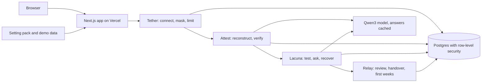
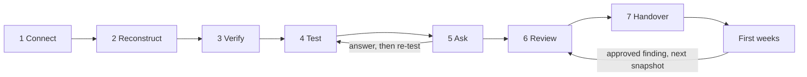

# Understudy

Understudy builds a handover from the record a leaving person left behind: chats, commits, the task board, notes and the calendar.
It tests the draft against the work the successor must do, and asks people only what the record cannot answer.
Each role then gets its own handover, with only what that role may see.

Team DRACONIX (CodersInPune) · Knowledge Handover challenge · Round 3

[](https://github.com/m4xy07/understudy/actions/workflows/ci.yml)

- **Live app:** https://understudy-lyart.vercel.app (no sign-up)
- **Click-by-click guide:** [docs/JUDGE_GUIDE.md](docs/JUDGE_GUIDE.md)
- **Run it yourself:** [Run it locally](#run-it-locally), about ten minutes from a fresh clone
- **Tests:** [TESTING.md](TESTING.md) · **Roadmap:** [docs/ROADMAP.md](docs/ROADMAP.md) · **Disclosures:** [DISCLOSURES.md](DISCLOSURES.md)
- **Evaluation:** [robotics club](docs/EVALUATION.md), [research group (the hold-out)](docs/EVALUATION.lab.md), [probe results](docs/PROBE_RESULTS.md)

> **The demo data is synthetic.** The people, the club, the research group and the companies are fictional. The data holds planted FAKE secrets (AWS-style keys, GitHub-style tokens, password lines) so the masking step has something to mask. None of them is real.

## Try it in ten minutes

Open the [live app](https://understudy-lyart.vercel.app). There are two demos. Each opens a private copy, and the run starts by itself. You change person with the **Viewing as** menu in the header.

### The robotics-club demo (about six minutes)

Priya, the outgoing tech lead of a college robotics club, graduates. The incoming tech lead takes over.

1. Press **Open the robotics-club demo**. You land on **Connect** as Club President. The **Run Understudy** panel reaches "Run finished" in a few seconds, because the demo replays stored model answers.
2. **Connect.** Eight sources with segment counts, masked secrets and contacts. Below them, the **Sensitive content** panel (Round 3, see below).
3. **Reconstruct.** Open any claim's citation. The source opens with the exact quote highlighted.
4. **Test.** Scores for the Incoming tech lead read **B · C · K**: blocking gaps, coverage, and the share of coverage backed by a record.
5. **Ask.** Switch **Viewing as** to **Priya (outgoing tech lead)**, answer one question and press **Save answer**. The answer is labelled "Leaver said" and the scores move.
6. **Review.** Switch to **Club President**. Press **Approve N tier A claims**, open a few groups under **Tier B by responsibility** and approve them, give each open blocking gap an owner, a due date and a risk note, then press **Approve snapshot v1**.
7. **Handover.** Switch to **Incoming tech lead**, then to **New member**, and compare. Restricted items become a count: "N restricted items. Ask the approver (Club President)."

### The three Round 3 improvements, and where to see each

| Improvement | Where | What to do |
|---|---|---|
| 1. Recovery when the leaver cannot be reached | **Ask**, as Club President | Under "Can Priya answer?" press **Priya can't be reached**. Every open gap goes down three rungs: people who worked on it, what the files and history show, and possible answers. Press **Switch to Arjun to answer**, then **Use a sample answer** and **Save answer**. The answer is saved as "Second-hand". The panel "With Priya and without" shows that fewer gaps close without her. |
| 2. Sensitive content | **Connect**, then **Handover** | On Connect, the **Sensitive content** panel lists messages from open channels that look like money, people or health matters. Each was limited to fewer roles before it was stored. Switch to **New member**: the panel shows only a count. At the bottom of **Handover**, the **Leak check** grid has two tables, "Exact tokens" and "Reworded facts". **See probe results** opens the page that says what the checks caught and what they missed. |
| 3. Living handover and a second setting | **First weeks**, and the second demo | After snapshot v1, switch to **Incoming tech lead** and open **First weeks**. Press **Record a finding**, **Use the example finding**, **Save finding**. As **Club President** on **Review**, tick "I opened the evidence", write a reason and press **Approve and release v2**. **Handover** now shows "What changed in v2". Then go back to the landing page and press **Open the research-group demo**. |

### The research-group demo (about three minutes)

Farhan, a postdoc, leaves a university research group. The same seven steps run with other roles (Principal investigator, Incoming postdoc, PhD student, Lab manager), other checklists and other sources. The setting is one pack file and one data folder. No core code names it.

[docs/JUDGE_GUIDE.md](docs/JUDGE_GUIDE.md) has every click and what to look for.

## How it works

Seven steps, in four modules. The stepper at the top of every page says which step is next.

| Step | Module | What happens |
|---|---|---|
| 1 Connect | **Tether** | Reads exports (WhatsApp, Slack, GitHub, task board CSV, Markdown notes, ICS calendar, or a public GitHub URL) into immutable segments. Masks secrets and contacts, and limits sensitive messages, before anything is stored. |
| 2 Reconstruct | **Attest** | The model drafts claims (entity, one of eleven attributes, value) with citations. Task board and calendar give claims by rule, with no model. |
| 3 Verify | **Attest** | Code checks every citation against the exact text, sets trust labels, and applies supersession and conflict rules. |
| 4 Test | **Lacuna** | Builds the list of responsibilities. A stand-in successor tries each typed checklist using only what that role may see. Code scores B, C and K. |
| 5 Ask | **Lacuna** | Up to ten ranked questions for the leaver. If the leaver cannot be reached, the recovery ladder asks neighbours, reads files and history, and lists options. |
| 6 Review | **Relay** | The approver works through tiers A, B and C, plans every open blocking gap, and approves a hashed snapshot. |
| 7 Handover | **Relay** | Each role gets its own handover compiled under its permissions, with stubs, a typed read-back and a leak check. First weeks then feeds findings into the next snapshot. |

**Trust labels**, strongest first: From record, Corroborated, Leaver said, Successor found, Second-hand, Inferred, Ranked options. Nothing a person said is ever labelled verified.

**Scores.** B = blocking checks not yet covered. C = weighted coverage. K = the share of that coverage backed by a record. The app always shows B, then C, then K, never one percentage.

**Rules we hold to.**

- **The database is the permission boundary.** Every role-scoped read runs as a restricted database role with row-level security, so rows a role may not see do not exist for that query (`src/lib/db/withRole.ts`).
- **The model proposes, code decides.** The model drafts claims and plays the stand-in successor. Code sets every label, role set, score, tier and approval. Handover text comes from fixed templates.
- **Exact quotes.** A claim is "From record" only when its quote is found word for word in the cited segment.
- **Append-only history.** Claim events, the audit log and acknowledgements cannot be updated or deleted. Snapshots are hashed with SHA-256 and versioned.
- **The leaver never approves.** Only the pack's approver role can. The server and a database trigger both check it.

## What is new in Round 3

We promised three improvements in Round 2. All three are built, tested and live.

1. **Recovery when the leaver cannot be reached.** The approver switches it on. A collaboration graph built from metadata only (no message text) finds who worked closest on each gap, and asks them only if their role may see the topic. A trace reader rebuilds procedures from workflow files, CI run history, commits and the calendar. What is still open gets ranked options. Neighbour answers are "Second-hand", traces are "Inferred", and options never count as answers. Recovery never raises K and never closes a blocking gap on its own word.
2. **Content-level confidentiality.** A classifier runs at ingest and narrows who can see a message by what it says (money, people matters, health), not only by where it was posted. If the model cannot be asked about a borderline message, the message is held for the approver. The club demo limits 9 messages this way. The leak check now covers more outputs and also looks for restricted facts in other words. [docs/PROBE_RESULTS.md](docs/PROBE_RESULTS.md) reports what was caught and missed.
3. **Living handover and a second setting.** The successor records findings in First weeks. An approved finding re-tests the successor and releases the next snapshot, with a "What changed" panel that explains each score. The research group is a second setting added with no setting-specific core code: [docs/round3/ZERO_CORE_CHANGES.md](docs/round3/ZERO_CORE_CHANGES.md).

Also in Round 3:

- **Better extraction.** A two-pass prompt with a consolidation pass by code. Recall on the club answer key went from 57.7% to 77.5%. On the research group, which we never tuned against, it reads 72.4%.
- **Reliability.** A run that needs more than one function invocation continues in slices. One run at a time per workspace. Double clicks and second tabs do not repeat work. Daily caps on live model calls. A daily cleanup of old demo copies.
- **CI** on every push: tests, a production build, and the browser suite with the model switched off.
- **An independent code review** of the Round 3 branch. We fixed 13 correctness and 8 security findings, each with a regression test. See [TESTING.md](TESTING.md).

**Changes of plan.** Invite links per role were on our Round 3 fix list and are not built; they are first on the [roadmap](docs/ROADMAP.md). The rule for choosing the extraction prompt changed from a club-only target to a comparison on the hold-out; [docs/round3/DECISIONS.md](docs/round3/DECISIONS.md) records both, with the numbers.

## Architecture





| Part | What we use |
|---|---|
| App | Next.js 16 (App Router), TypeScript, Tailwind CSS, on Vercel |
| Database | Postgres 16: Supabase in production, Docker locally |
| Model | Qwen3, through any OpenAI-compatible endpoint. Hosted: `qwen/qwen3-32b` on OpenRouter. Local: `qwen3:8b` on Ollama |
| Settings | `packs/club.json` and `packs/lab.json`, validated at load |

Every model call goes through `src/lib/model/client.ts` and is cached by a hash of the model, the prompt and the schema. The answers both demos need are committed in `data/demo/model_cache.json` and `data/lab/model_cache.json`. The full contract is in [docs/ARCHITECTURE.md](docs/ARCHITECTURE.md).

## Run it locally

**You need no model key.** Both demos replay from the committed caches. A key, or a local model, is only needed to process your own uploads.

### What you need

| Tool | Version | Check |
|---|---|---|
| Git | any recent | `git --version` |
| Node.js | 20 or newer (CI uses 22; we also ran 26) | `node -v` |
| pnpm | 10 | `pnpm -v`. To install: `corepack enable`, or `npm install -g pnpm@10` |
| Docker | Docker Desktop or Docker Engine with Compose, running | `docker ps` |

Ports 3000 (app) and 45432 (database) should be free. If not, see [Troubleshooting](#troubleshooting).

The commands below are the same in PowerShell, cmd, bash and zsh.

### Steps

```bash
git clone https://github.com/m4xy07/understudy
cd understudy
pnpm install
```

About 10 seconds with a warm pnpm store, a minute or two on a first install. A warning "Ignored build scripts: esbuild" is expected and harmless.

Create `.env.local` from `.env.example` with two fresh random keys. Paste this as one line:

```bash
node -e "const fs=require('fs'),c=require('crypto');let t=fs.readFileSync('.env.example','utf8');for(const k of ['IDENTITY_KEY','CONTACTS_KEY'])t=t.replace(new RegExp('^'+k+'=.*','m'),k+'='+c.randomBytes(32).toString('base64'));fs.writeFileSync('.env.local',t)"
```

It prints nothing. The file now has a database URL for the Docker database, the two keys, and the model name and host that the committed caches were made with. Leave `MODEL_API_KEY` empty.

```bash
pnpm db:up
pnpm db:migrate
pnpm db:seed
pnpm dev
```

| Command | What it does | What you should see |
|---|---|---|
| `pnpm db:up` | Starts Postgres 16 in Docker on `localhost:45432` | `Container understudy-db Healthy`. The first run downloads the image, which can take a minute. |
| `pnpm db:migrate` | Applies `db/migrations/*.sql` in order | `12 migration(s) applied` |
| `pnpm db:seed` | Loads the stored model answers of both demos | `seeded 868 model cache row(s): 868 new, 0 replaced, 0 already current` |
| `pnpm dev` | Starts the app | `Local: http://localhost:3000` and `Ready` |

### What working looks like

Open http://localhost:3000. The landing page shows two cards.

- Press **Open the robotics-club demo**. Within about five seconds the Run Understudy panel shows five steps as Done and the line "Run finished. Open Reconstruct to see the claims." The Reconstruct step reads "Read 31 batches (31 from the cache)". Connect lists 8 sources and 466 segments. Test reads B 4 · C 76% · K 100% for the Incoming tech lead.
- Go back and press **Open the research-group demo**. It finishes in about two seconds: 7 sources, 191 segments, "Read 25 batches (25 from the cache)", B 6 · C 69% · K 100% for the Incoming postdoc.

If a batch count says fewer came from the cache, the seed did not run or the model settings were changed: see Troubleshooting.

Stop the app with Ctrl+C. Stop the database with `pnpm db:down` (the data stays in a Docker volume).

### Your own files, with a model

Without a key the demos work fully. An upload still imports, and task boards and calendars still give claims by rule, but chat and notes need the model: the Reconstruct step then reports the batches that failed (with OpenRouter and no key, "HTTP 401").

Pick one, edit `.env.local`, and restart `pnpm dev`:

- **OpenRouter (hosted, the same model as the live demo).** Create a key at https://openrouter.ai/keys and set `MODEL_API_KEY=<your key>`. Leave `MODEL_BASE_URL` and `MODEL_NAME` as they are. The demos still replay from the cache at no cost.
- **Ollama (fully local, no text leaves your machine).** Install Ollama, run `ollama pull qwen3:8b`, then set:

  ```
  MODEL_BASE_URL=http://localhost:11434/v1
  MODEL_NAME=qwen3:8b
  MODEL_API_KEY=ollama
  ```

  The cache key includes the model name and host, so with Ollama the demos no longer replay: the local model reads every batch. That is slower (minutes, depending on your hardware) and its claims can differ from the hosted demo.

Then on the landing page press **Start empty and upload my files**. One upload is at most 4.5 MB. Please do not upload real or confidential data to the live link.

`.env.example` documents every variable, including the optional ones (model call caps, cleanup, run slice budget, extraction variant).

## Tests and CI

```bash
pnpm test
```

Needs the database from the steps above (started and migrated). It never calls a model. Our run on a fresh clone: **77 test files, 992 tests passed, 1 skipped, in 67 seconds**. The skipped test needs a Supabase pooler URL.

End-to-end tests drive a real browser through both demos, recovery, First weeks and the abuse cases. Keep `pnpm dev` running in one terminal, then in a second one:

```bash
pnpm exec playwright install chromium
pnpm test:e2e
```

Our run on a fresh clone, with no model key: **9 passed in 3.2 minutes**. The first command downloads Chromium once.

To run them against the live app instead, set `E2E_BASE_URL` first:

```bash
# bash, zsh
E2E_BASE_URL=https://understudy-lyart.vercel.app pnpm test:e2e
# PowerShell
$env:E2E_BASE_URL="https://understudy-lyart.vercel.app"; pnpm test:e2e
```

**CI.** `.github/workflows/ci.yml` runs on every push and pull request to `main`, with no secrets and the model switched off. One job migrates, seeds, runs `pnpm test` and builds. A second job builds, starts the app and runs the browser suite.

[TESTING.md](TESTING.md) says what each suite covers. Other scripts: `pnpm build`, `pnpm start`, `pnpm lint`, `pnpm check:literals`, `pnpm tsx scripts/eval.ts` (add `--pack lab` for the research group).

## Troubleshooting

Problems we hit while following these steps on clean clones, and a few more the setup can run into.

| Problem | Fix |
|---|---|
| Port 45432 is taken by another program | In `docker-compose.yml` change `"45432:5432"` to a free port, for example `"45440:5432"`. In `.env.local` change `45432` in `DATABASE_URL` to the same number. Run `pnpm db:up` again. |
| You already have a copy of this project on the machine, with its database running | Use that database: skip `pnpm db:up`, and run `pnpm db:migrate` and `pnpm db:seed` (both are safe to repeat). Do not start a second database from a folder that is also named `understudy`: Docker Compose names the project after the folder, so it would replace the first container. If you want a separate database, set `COMPOSE_PROJECT_NAME` to another name in your shell first, then change `container_name` and the port in `docker-compose.yml` and the port in `.env.local`. |
| `pnpm db:up` cannot reach Docker | Docker is not running. Start Docker Desktop and wait until it says it is running. |
| `pnpm install` warns "Ignored build scripts: esbuild" | Expected. Nothing to do. |
| The demo page says "IDENTITY_KEY and CONTACTS_KEY must be set" | `.env.local` is missing or the keys are empty. Run the `node -e` line again, then restart `pnpm dev`. |
| The demo takes minutes, or Reconstruct says "batches failed (HTTP 401 ...)" | The stored answers were not found. Run `pnpm db:seed`, and check that `MODEL_BASE_URL` and `MODEL_NAME` in `.env.local` match `.env.example`. Then open a fresh demo. |
| `pnpm dev` says port 3000 is in use and picks another port | Open the address it prints. For the browser tests, set `E2E_BASE_URL` to that address. |
| `pnpm test` fails at once with a connection error | The database is not running or not migrated. Run `pnpm db:up` and `pnpm db:migrate`. |
| You want a clean database | `pnpm db:down`, then `docker volume rm understudy_understudy-pg`, then `pnpm db:up`, `pnpm db:migrate`, `pnpm db:seed`. The volume name starts with the folder name of your clone, in lower case. This deletes every local workspace. |

## Project layout

```
src/app/                 landing page and /w/[id]/{connect,claims,test,ask,review,handover,first-weeks,probes,evaluation,source}
src/app/api/             upload, GitHub import, run, Markdown export, daily cleanup
src/components/          shared UI: stepper, role switcher, run panel, chips, scores, what changed
src/lib/tether/          adapters, masking, identity, footprint, sensitivity classifier, visibility, graph, traces
src/lib/attest/          extraction (two prompt variants), consolidation, verifier, rules, flag visibility, evaluation
src/lib/lacuna/          inventory, checklists, stand-in successor, scores, questions, plan, recovery ladder
src/lib/relay/           tiers, snapshot, compile, stubs, read-back, findings, what changed, leak check, probes
src/lib/pipeline/        run orchestration: leases, slices, spend caps, cleanup
src/lib/db/              Postgres client, withRole, queries
src/lib/model/           OpenAI-compatible client and cache
src/lib/pack/            setting-pack loader and schema
db/migrations/           0001 to 0013, plain SQL
packs/                   club.json, lab.json, index.json
data/demo/, data/lab/    synthetic exports, answer keys, stored model answers
scripts/                 migrate, seed, eval, precompute, probe-eval, check-demo, check-literals, check-zero-core
tests/                   vitest suites per module, db/ (row-level security), pipeline/, e2e/ (Playwright)
docs/                    ARCHITECTURE, JUDGE_GUIDE, ROADMAP, EVALUATION, PROBE_RESULTS, round3/ (plan, specs, decisions)
```

## Honest limits

- **The role switcher is not sign-in.** Anyone with a workspace link can pick any role. The database enforces what the chosen role sees; it does not prove who the visitor is. Invite links come first on the roadmap.
- **Extraction is good, not complete.** It finds about three in four planted facts and also produces claims outside the answer key. That is why every claim carries a citation and a person approves before anything is released.
- **Reworded leaks are mostly caught.** The two checks together caught 31 of 36 planted rewordings. The approver can limit any message by hand, and the change applies at once.
- **Your own uploads need a model and an open tab.** A long run continues in slices while a workspace page is open.

## Roadmap

[docs/ROADMAP.md](docs/ROADMAP.md): invite links and real sign-in, live connectors with scoped permissions, a bus-factor view before anyone leaves, more setting packs, self-hosted model packaging, and an accessibility audit. Each has the user it serves, the work, and what must be true first.

## Team DRACONIX

| Person | Module | Round 3 lead |
|---|---|---|
| Aman Shaikh | Team lead; Tether: data and ingestion | Recovery |
| Advait Dikshit | Lacuna: gaps and continuity | Living handover |
| Om Manish Vibhute | Attest: evidence and verification | Trace verification, the research-group pack |
| Yash Mahajan | Relay: handover and trust | Confidentiality, interface |

AI coding tools wrote much of the code and documentation under our direction and review. [DISCLOSURES.md](DISCLOSURES.md) has the details.

## Licence

MIT. See [LICENSE](LICENSE). Third-party libraries keep their own licences, listed in [DISCLOSURES.md](DISCLOSURES.md).
