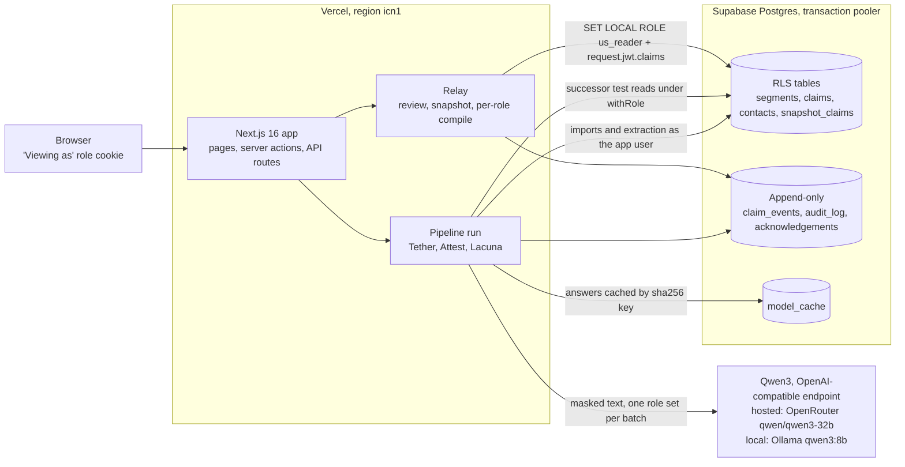
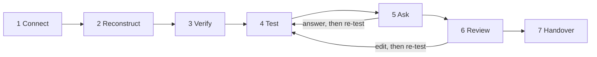

# Understudy

A handover that finds what the leaving person actually did, tests the draft against the work the successor must do, asks only what the record cannot answer, and shows each role only what it may see.

Team DRACONIX (CodersInPune) · Knowledge Handover challenge · Round 2 build

- **Live app:** https://understudy-lyart.vercel.app
- **Repository:** https://github.com/m4xy07/understudy
- **Click-by-click guide:** [docs/JUDGE_GUIDE.md](docs/JUDGE_GUIDE.md)
- **Evaluation report:** [docs/EVALUATION.md](docs/EVALUATION.md)
- **Tests:** [TESTING.md](TESTING.md) · **Disclosures:** [DISCLOSURES.md](DISCLOSURES.md)

> **Note on the demo data.** The demo data is synthetic. It contains deliberately planted FAKE secrets (an AWS-style key pair, a GitHub-style token, a password line) so the masking step can be demonstrated; the masking tests add more, including a Slack-style token. None of them is real. The people, the club and the companies are fictional too.

## Try it in 5 minutes

The demo is a fictional college robotics club. Priya, the outgoing tech lead, graduates. The incoming tech lead has to take over. You switch between people with the **Viewing as** menu in the header; there is no sign-up.

1. Open the [live app](https://understudy-lyart.vercel.app) and press **Open the robotics-club demo**. You get a private copy of the workspace, and the run starts by itself.
2. **Connect.** Eight sources (WhatsApp, three Slack channels, a GitHub repo, the task board, meeting notes, a calendar) with segment counts, masked secrets and contacts, rejected rows and the data level reached. The run panel shows each step until it says Done. The demo replays precomputed model answers, so it finishes in a few seconds; your own uploads call the model live and can take a few minutes.
3. **Claims.** Every claim has an attribute, a trust label and citations. Click a citation: the source opens with the exact quote highlighted. Superseded and Conflicting claims say which rule fired.
4. **Test.** For the Incoming tech lead, read **B · C · K** (blocking gaps, coverage, record-backed share) and the grid of Covered, Partial, Missing and Restricted checks per responsibility.
5. Switch **Viewing as** to **Priya (outgoing tech lead)** and open **Ask**. Answer one or two of the ranked questions. Answers come back labelled "Leaver said", and the re-test line shows how B, C and K moved.
6. Switch to **Club President** and open **Review**. Bulk approve tier A, give an owner, due date and risk note to every open blocking gap in the continuation plan, then press **Approve snapshot v1**. The SHA-256 hash appears, and the release line says "Released with N open blocking gaps" when gaps remain.
7. Switch to **Incoming tech lead** and open **Handover**. Read the I-PASS sections and the restricted stub ("N restricted items. Ask the approver (Club President)."). Type the five read-back items, press **Check my read-back**, then **Acknowledge receipt**.
8. Switch to **New member** on the same page and compare: no restricted values, and approved items from sources the New member may not see (#infra, #finance) become part of a larger stub. At the bottom, the **Leak check** grid compiles every role's handover and scans every surface for planted canary tokens.

[docs/JUDGE_GUIDE.md](docs/JUDGE_GUIDE.md) has the same path with what to look for at each step.

## How it works

Seven steps, in four modules. The stepper at the top of every page says which step is next.

| Step | Module | What happens |
|---|---|---|
| 1 Connect | **Tether** | Reads exports (WhatsApp, Slack, GitHub, task board CSV, Markdown notes, ICS calendar, or a public GitHub URL) into immutable segments with stable IDs. Masks secrets and contacts before anything is stored. |
| 2 Reconstruct | **Attest** | The model extracts claims (entity, one of eleven attributes, value) per thread, one role set per batch. Task board and calendar give claims by rule, with no model. |
| 3 Verify | **Attest** | Code checks every citation against the exact text, sets trust labels, and applies supersession and conflict rules. |
| 4 Test | **Lacuna** | Builds the responsibility inventory (task board, the leaver's footprint, role template). A stand-in successor tries each typed checklist using only what that role may see. Code scores B, C and K. |
| 5 Ask | **Lacuna** | Up to ten ranked gap questions for the leaver. Answers become claims labelled "Leaver said", then the test runs again. |
| 6 Review | **Relay** | The approver works through tiers A, B and C, plans every open blocking gap, and approves a hashed snapshot. |
| 7 Handover | **Relay** | Each role gets its own handover compiled from the snapshot under its permissions, with stubs, a decision timeline, a typed read-back, acknowledgements and a leak check. |

- **Tether** (Connect): adapters, masking, identity matching, data level.
- **Attest** (Reconstruct, Verify): extraction, exact-quote verifier, support check, supersession and conflict rules, claim ledger.
- **Lacuna** (Test, Ask): inventory, checklists, stand-in successor, B / C / K, gap questions, re-test, continuation plan.
- **Relay** (Review, Handover): review tiers, snapshot and release rule, per-role compile, stubs, read-back, canary leak check, Markdown export.

### Words the app uses

**Coverage** of a check, per role: Covered, Partial, Missing, Restricted (evidence exists but this role may not see it), Conflicting.

**Trust**, strongest first:

| Label | Meaning |
|---|---|
| From record | The cited quote is found word for word in the source. |
| Corroborated | Two independent sources agree, and at least one is backed by a record. |
| Leaver said | Priya's answer on the Ask page. Raises C, not K, until a record backs it. |
| Second-hand | Someone else reporting what was said. |
| Inferred | Cited, but the quote did not match exactly. |
| Ranked options | Not settled; options listed. |

Nothing a person said is ever labelled verified.

**Scores.** B = blocking checks not yet covered. C = weighted coverage. K = the share of that coverage backed by a record. The app always shows B, then C, then K, never one percentage, and marks scores provisional until review.

## Architecture





The full contract is in [docs/ARCHITECTURE.md](docs/ARCHITECTURE.md). The Round 2 plan is in [docs/plan/2026-11-11-round2-build-plan.md](docs/plan/2026-11-11-round2-build-plan.md).

## Key technical decisions

- **RLS is the compile boundary.** Every role-scoped read (successor test, gap questions, handover, export) runs in `withRole()`: `BEGIN; SET LOCAL ROLE us_reader; set_config('request.jwt.claims', {workspace_id, role_key}); ...; COMMIT`. Row-level security is enabled and forced on `segments`, `claims`, `contacts` and `snapshot_claims`, so rows a role may not see do not exist for that query. Stub counts come from `count_withheld()`, a `SECURITY DEFINER` function that returns only an integer. See `src/lib/db/withRole.ts` and `db/migrations/0001_core.sql`.
- **Masking before storage and before model calls.** Secrets (GitHub, AWS, Slack, OpenAI-style keys, private keys, `password=` / `token=` lines, high-entropy tokens) become `[SECRET:<type>]` and the value is thrown away. Emails and phone numbers become `[CONTACT:p-n]`; the real value is stored AES-256-GCM encrypted and shown only to roles the setting pack allows. People merge only on an exact email, compared as HMAC-SHA256.
- **Exact-quote rule.** A claim is "From record" only if the normalised quote is a substring of the normalised segment the model was shown. A citation to a segment outside the batch is rejected. A claim with no accepted citation is dropped and counted per source.
- **The model proposes, rules decide.** The model drafts claims and plays the stand-in successor. Code sets every label, role set, status, score, tier and approval. The support check can only lower trust. Handover text is rendered from fixed templates; the model never rewrites it.
- **Append-only ledgers.** `claim_events`, `audit_log` and `acknowledgements` have no UPDATE or DELETE grants; `claims` is the current projection. Segments are immutable; a changed re-import makes a new version.
- **SHA-256 snapshots.** The snapshot is canonical JSON of the approved claims, their evidence segment IDs and versions, and the continuation plan, hashed and versioned (v1, v2, ...). Only the Club President can approve; the leaver never can (server check plus tests). With B > 0 the snapshot cannot be approved until every blocking gap has an owner, a due date and a risk note, and it is then labelled "Released with N open blocking gaps", never complete.
- **Transaction-pooler fix.** On Vercel, pages hung because postgres.js pipelines queries on one connection and Supabase's transaction pooler (Supavisor, port 6543) did not answer pipelined queries. The pool now runs with `max_pipeline: 1` and a `query_timeout` (commit `7184910`, regression test `tests/db/pool.test.ts`). Details in [TESTING.md](TESTING.md).
- **One setting pack.** Roles, attributes, source authority, checklists, footprint thresholds and read-back items live in `packs/club.json`, validated by zod. Core code reads the pack and does not branch on the setting.

## Models and services

| What | Used for | Why |
|---|---|---|
| Qwen3 32B (`qwen/qwen3-32b`) via OpenRouter | The hosted demo and uploads on the live link | OpenRouter retired Qwen3 8B (`qwen/qwen3-8b`) on 9 Oct 2026, and a public link cannot reach a laptop GPU. Same open-weight Qwen3 family. |
| Qwen3 8B (`qwen3:8b`) on Ollama | Fully local use | No source text leaves the machine. |
| Supabase (Postgres) | Production database with RLS | The compile boundary promised in Round 1. |
| Vercel | Hosting, functions pinned to `icn1` next to the database | One public link, no sign-up. |

Every model call goes through `src/lib/model/client.ts`. Answers are cached by `sha256(model tag + prompt + schema)` in the `model_cache` table, and the demo's precomputed extraction answers are committed in `data/demo/model_cache.json`, so the demo replays the same claims. Output is parsed with zod, with one retry on invalid JSON. If the model is unreachable, the step says "Model unavailable" and the rule-based paths (task board, calendar, deterministic successor test) still run.

## Run it locally

You need Node 20+, pnpm 10 and Docker.

```bash
pnpm install
cp .env.example .env.local      # then fill IDENTITY_KEY and CONTACTS_KEY (see below)
pnpm db:up                      # Postgres 16 in Docker on localhost:45432
pnpm db:migrate                 # applies db/migrations/*.sql in order
pnpm db:seed                    # loads data/demo/model_cache.json into model_cache
pnpm dev                        # http://localhost:3000
```

Environment variables (`.env.example` lists them all):

| Variable | What |
|---|---|
| `DATABASE_URL` | Local Docker Postgres (default in `.env.example`) or a Supabase connection string. |
| `MODEL_BASE_URL`, `MODEL_NAME`, `MODEL_API_KEY` | Any OpenAI-compatible chat endpoint. |
| `IDENTITY_KEY`, `CONTACTS_KEY` | 32 random bytes, base64. Generate with `node -e "console.log(require('crypto').randomBytes(32).toString('base64'))"`. |
| `GITHUB_TOKEN` | Optional. Raises the GitHub API rate limit for public repo imports. |

**Which model.** The cache key includes the model name and host, so cached answers replay only for the model that made them.

- To replay the demo exactly as hosted, set `MODEL_BASE_URL=https://openrouter.ai/api/v1` and `MODEL_NAME=qwen/qwen3-32b`. Cached prompts need no network call; add an OpenRouter key in `MODEL_API_KEY` for anything not cached.
- To run fully local with Ollama: `ollama pull qwen3:8b`, then set `MODEL_BASE_URL=http://localhost:11434/v1`, `MODEL_NAME=qwen3:8b`, `MODEL_API_KEY=ollama`. The first run calls the local model for every batch, so it is slower and its claims can differ from the hosted demo.

Other scripts: `pnpm build`, `pnpm lint`, `pnpm db:down`, `pnpm db:export-cache` (writes the `model_cache` table back to `data/demo/model_cache.json`).

## Tests

```bash
pnpm db:up && pnpm db:migrate   # the integration and permission suites need a migrated database
pnpm test

# End-to-end: the five-minute judge path in Chromium (first time: pnpm exec playwright install chromium)
pnpm test:e2e                                                   # against pnpm dev on localhost:3000
E2E_BASE_URL=https://understudy-lyart.vercel.app pnpm test:e2e  # against the live app
```

Vitest covers each module's rules, the RLS boundary, the leaver-cannot-approve rule, the canary leak check and the pooler regression. The Playwright suite walks the judge path in a real browser on a fresh copy of the demo. [TESTING.md](TESTING.md) lists what each suite covers, the end-to-end result and the manual checks on the live link. Extraction quality against the planted ground truth is in [docs/EVALUATION.md](docs/EVALUATION.md).

## Against the Round 1 plan

We built the Round 1 minimum loop. What changed, and why:

| Round 1 plan | Round 2 build | Why |
|---|---|---|
| Python 3.12 workers on a Postgres job queue | TypeScript server code in the Next.js app; each run is a row in `runs` with per-step progress | One deployable link, one language. |
| detect-secrets + Presidio | A TypeScript port of the same detector types | The Python libraries cannot run inside the Next.js app. |
| Qwen3 8B everywhere | Qwen3 8B locally, Qwen3 32B on the hosted link | OpenRouter retired the 8B model; a public link cannot reach a laptop GPU. |
| Accounts per project | A "Viewing as" role switcher and a private workspace copy per visitor | Judges need links that work without signing in. |
| About 1,500 messages, 300 commits, 120 tasks | A smaller synthetic pack with planted ground truth | Time. We report measured numbers, not the Round 1 design values. |

## Round 3 commitments

1. **Unreachable-leaver recovery.** Done when, with "leaver unreachable" on, the same gaps reach a knowledge neighbour and a trace, fewer close, and every result shows its weaker label.
2. **Content-level confidentiality.** Done when the wider canary suite (every role, every output, including stubs and conflict flags) passes and paraphrase probes are written up.
3. **Living handover and a second setting.** Done when a successor finding goes through review into snapshot v n+1 with the score change explained, and the research-group pack runs with zero core code changes.

## Project layout

```
src/app/                 landing page and /w/[id]/{connect,claims,test,ask,review,handover,evaluation,source}
src/app/api/w/[id]/      upload, GitHub import, run, Markdown export
src/components/          shared UI: stepper, role switcher, run panel, chips, scores
src/lib/tether/          adapters, masking, identity, footprint, ingest
src/lib/attest/          extraction, verifier, support check, rules, evaluation
src/lib/lacuna/          inventory, checklists, stand-in successor, scores, questions, plan
src/lib/relay/           tiers, snapshot, compile, stubs, read-back, canary leak check
src/lib/db/              Postgres client, withRole, queries
src/lib/model/           OpenAI-compatible client and cache
src/lib/pack/            setting-pack loader and schema
src/lib/pipeline/        run orchestration across steps
db/migrations/           0001_core, 0003_attest, 0004_lacuna, 0005_relay
packs/club.json          the robotics-club setting pack
data/demo/               synthetic exports, sources.json, ground_truth.json, model_cache.json
scripts/                 migrate, seed, export-cache, precompute, eval, check-demo
tests/                   vitest suites per module plus db/ (RLS, pipeline, pool)
docs/                    ARCHITECTURE.md, EVALUATION.md, JUDGE_GUIDE.md, plan/
```

## Team DRACONIX

| Person | Role |
|---|---|
| Aman Shaikh | Team lead; Tether: data and ingestion |
| Advait Dikshit | Lacuna: gaps and continuity |
| Om Manish Vibhute | Attest: evidence and verification |
| Yash Mahajan | Relay: handover and trust |

## Licence

There is no licence file in this repository yet. Third-party libraries keep their own licences; see [DISCLOSURES.md](DISCLOSURES.md).
